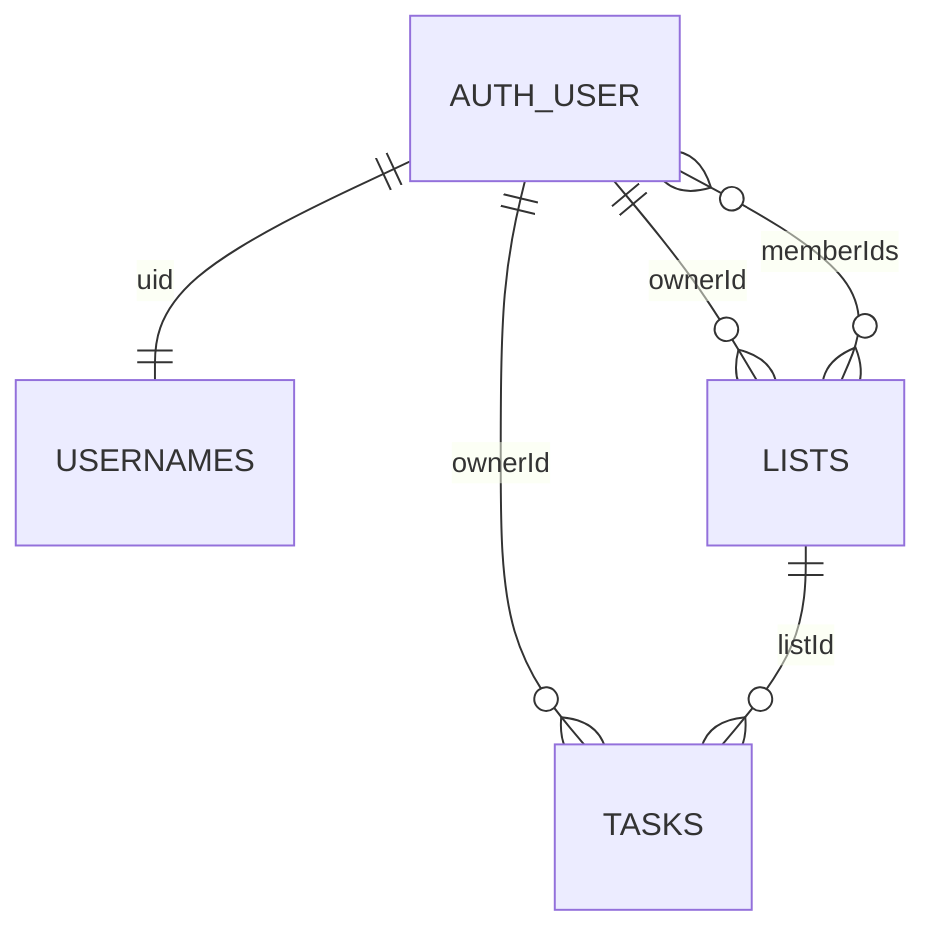
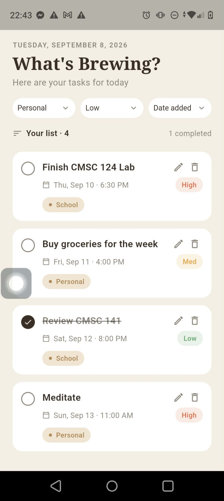
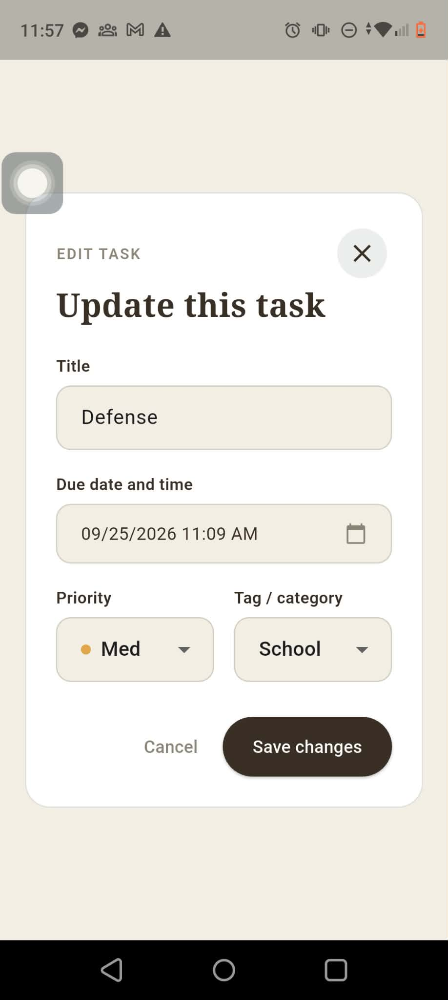
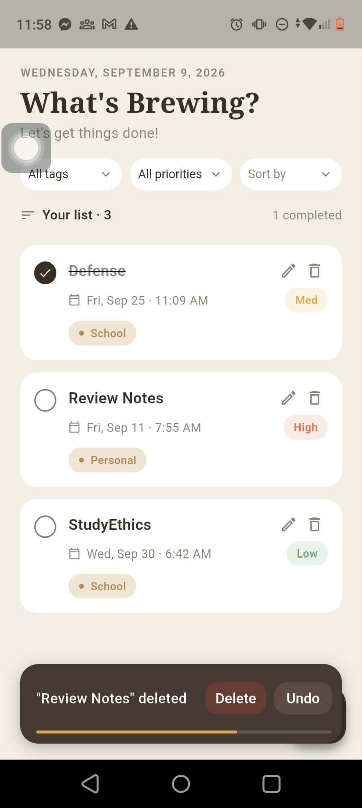

# To-Do List App (Multi-Account CRUD with User-Based Access Control)

A Flutter task-management app with Firebase email/password accounts. Each user
has a private **Personal** list and can create **Collaborative** lists, add
other users by username or email, and work on shared tasks together. Access is
enforced on the backend by Cloud Firestore Security Rules, not just in the UI.

This is the merged result of Activity 1 (CRUD To-Do List) and Activity 2
(Authentication and User Accounts), extended for Activity 3 (UBAC).

## Features

- Create an account with display name, username, email, and password.
- Sign in with username or email; sign out from the task list or account
  settings. After login the user lands directly on their own To-Do List.
- Request a password reset by username or email.
- Update display name and username; change email or password after confirming
  the current password. Email changes require verification.
- Create and edit tasks with a due date and time, priority, and tag; mark tasks
  complete or incomplete.
- Filter by tag and priority, sort by due date, priority, tag, or date added,
  and see task/completion counts.
- Delete with a four-second undo window, or confirm permanent deletion.
- Live updates through Firestore snapshots.
- **Personal list:** tasks only the owner can see or change.
- **Collaborative lists:** create a list, switch between lists from a dropdown
  (each shows its task count), and add members by username or email (owner
  only). A user sees only the lists they own or were added to.

## Technology

- **Frontend:** Flutter and Dart; targets Android and web.
- **State management:** Provider with `ChangeNotifier`.
- **Backend services:** Firebase Authentication (accounts, password hashing,
  sessions) and Cloud Firestore (data). The app uses Firebase's client SDKs
  directly, with no separate application server or REST API.
- **Authorization:** Firestore Security Rules (`firestore.rules`).
- **Other packages:** `intl` for date formatting.

---

## How Activity 1 and Activity 2 Were Merged

Basically, there were no merge conflicts because each new activity branch was created from the previous activity branch instead of from `main`. For example, after implementing the CRUD functionality for Activity 1, I created a new branch, `act2-accounts`, while retaining all the progress from Activity 1. Then, when I started Activity 3, I created the `act3-ubac` branch while still on `act2-accounts`. This way, each new branch builds on top of the previous activity's progress without merging the branches into `main` after every activity.

**Branch strategy**

| Branch | Contents |
| --- | --- |
| `crud-branch` & `ui-branch` | CRUD To-Do List: task model, `TaskService`, `TaskProvider`, task screens and widgets |
| `act2-accounts` | Firebase Auth, username mapping, sign-in/up/recovery/profile screens |
| `act3-ubac` | Created from `act2-accounts`, then the CRUD branch was merged in with `git merge`; conflicts were resolved on this branch |

`main` was not developed on directly.

**What changed when merging**

- `AuthGate` in `main.dart` now sends signed-in users straight to
  `TaskListScreen`, and everyone else to `SignInScreen`.
- `Task` gained `ownerId` and `listId`. Existing task code that assumed one
  global task collection was updated.
- `TaskService.getTasks()` no longer reads the whole collection. It filters by
  the signed-in user (personal) or by list (collaborative).
- `TaskService.addTask()` lets Firestore generate the document ID and stamps
  `ownerId` from `FirebaseAuth.instance.currentUser`, so a client cannot choose
  another user's ID.
- `TaskProvider` listens to `authStateChanges()` and, on every sign-in or
  sign-out, cancels the previous user's streams and clears tasks, lists,
  filters, and undo state so one user's data never carries over to the next.
- `firestore.rules` replaced the old `allow read, write: if true` with
  ownership and membership rules.
- The README was rewritten (this file).


- `main.dart`: both branches defined `home`. Kept the Activity 2 `AuthGate`
  and the Activity 1 `ChangeNotifierProvider`, combined.
- `task_list_screen.dart`: added the log-out and profile actions from
  Activity 2 to the Activity 1 screen.
- `README.md` and `firestore.rules`: kept the new versions from this branch.

---

## Schema

Users live in Firebase Authentication (credentials are never stored in
Firestore). Firestore has three collections.



### `tasks/{taskId}`

| Field | Type | Description |
| --- | --- | --- |
| `id` | string | Document ID (generated by Firestore) |
| `ownerId` | string | UID of the user who created the task |
| `listId` | string | `personal`, or the ID of a collaborative list |
| `title` | string | Task title (required) |
| `dueDateTime` | timestamp | Due date and time |
| `createdAt` | timestamp | Creation time |
| `priority` | string | `low`, `medium`, or `high` |
| `tag` | string | `school`, `personal`, or `others` |
| `isDone` | boolean | Whether the task is complete |

### `lists/{listId}`

| Field | Type | Description |
| --- | --- | --- |
| `id` | string | Document ID |
| `name` | string | List name (1 to 60 characters) |
| `ownerId` | string | UID of the creator; never changes |
| `memberIds` | list of strings | UIDs allowed in the list; always includes the owner |
| `createdAt` | timestamp | Creation time |

The **Personal** list is not a document. It is any task with
`listId == 'personal'` and `ownerId == <your uid>`.

### `usernames/{username}`

| Field | Type | Description |
| --- | --- | --- |
| `uid` | string | Firebase Auth UID of the account |
| `email` | string | Account email, so a username can be resolved to an email at sign-in |

Usernames are 3 to 20 lowercase letters, digits, or underscores. This is the
only intentional denormalization (the email also exists in Auth).
`AuthService.syncUsernameEmail()` keeps it in step after an email change.

Tasks and lists store only UIDs, never names or emails, so user data is not
duplicated inside task records.

### How they relate

- A task belongs to one user (`ownerId`) and one list (`listId`).
- A collaborative list has one owner and many members (`memberIds`).
- Visibility: a personal task is visible only to its owner; a shared task is
  visible to every member of its list.

---

## Access Control (UBAC)

Authentication is handled by Firebase Auth, so password hashing and session
handling are reused rather than re-implemented. Authorization is enforced by
**Firestore Security Rules on the server**. The UI only hides controls for
convenience; removing a check from the app does not open any data.

### Key rules (from `firestore.rules`)

```
function isListMember(listId) {
  return isSignedIn() && request.auth.uid in listData(listId).memberIds;
}

// Personal task: only its owner. Shared task: any member of its list.
function canAccessTask(data) {
  return isSignedIn() && (
    (data.listId == 'personal' && data.ownerId == request.auth.uid)
    || (data.listId != 'personal' && isListMember(data.listId))
  );
}
```

### Operations and where ownership is checked

| Operation | App code | Rule that enforces it |
| --- | --- | --- |
| Read my personal tasks | `getTasks(uid)` queries `ownerId == uid` and `listId == 'personal'` | `allow read: if canAccessTask(resource.data)` |
| Read a shared list's tasks | `getTasks(uid, listId: id)` queries `listId == id` | Same rule; passes only if `uid` is in `memberIds` |
| Create a task | `addTask()` sets `ownerId` to the signed-in UID | `ownerId == request.auth.uid` and `canAccessTask(new data)` |
| Update a task | `updateTask()` | `canAccessTask(old data)`; `ownerId` and `listId` cannot change |
| Delete a task | `deleteTask()` | `canAccessTask(old data)` |
| See my lists | `getMyLists(uid)` uses `memberIds arrayContains uid` | `allow read` only if `uid in memberIds` |
| Create a list | `createList()` | Caller is `ownerId` and the only initial member |
| Add a member | `addMember()` uses `FieldValue.arrayUnion` | `allow update` only if `resource.data.ownerId == request.auth.uid` |
| Delete a list | not exposed in the UI | Owner only |

```dart
// Personal tasks: filtered by owner AND the personal list.
_firestore.collection('tasks')
    .where('ownerId', isEqualTo: uid)
    .where('listId', isEqualTo: kPersonalListId);

// Shared tasks: the rules reject this query unless uid is a member.
_firestore.collection('tasks').where('listId', isEqualTo: listId);

// My lists: only lists whose memberIds contains my uid.
_firestore.collection('lists').where('memberIds', arrayContains: uid);
```

### IDOR prevention

Changing a task ID or list ID does nothing. A request for another user's
personal task fails the `ownerId == request.auth.uid` check, and a request for
a list the user was not added to fails `isListMember()`. Both return
`permission-denied`, never the data.

### Design decisions and trade-offs

- **Shared-list permissions:** any member can add, edit, complete, or delete
  tasks in a shared list. Only the list owner can add members or rename the
  list. Members cannot change a task's `ownerId` or `listId`.
- **Public username lookup:** `usernames` allows a single-document `get`
  without sign-in, because username login must resolve the email before the
  user is authenticated. Bulk listing is blocked.
- **Email lookup when adding a member:** signed-in users may run a
  single-result `usernames` query (`limit <= 1`) so "add by email" works. This
  lets a signed-in user check whether an email is registered. A Cloud Function
  would remove this exposure in production.
- **Password reset:** the app shows a generic confirmation when no account is
  found, so it does not reveal whether an account exists.

---

## Prerequisites

- Flutter SDK and the Dart SDK version allowed by `pubspec.yaml` (`^3.13.2`).
- Android Studio/emulator or a connected Android device, or a supported
  browser such as Chrome for web runs.
- Firebase CLI (for deploying the rules).
- Access to the Firebase project configured in `lib/firebase_options.dart`.

## Installation and Local Run

```bash
git clone <repository-url>
cd <repository-folder>
git checkout act3-ubac

flutter doctor
flutter pub get
flutter devices
flutter run
```

Use `flutter run -d chrome` to run in Chrome, or replace `chrome` with a device
ID shown by `flutter devices`. Run the widget tests with:

```bash
flutter test
```

### Firebase setup

1. Open the Firebase project referenced by `lib/firebase_options.dart` and
   `android/app/google-services.json`.
2. In **Authentication > Sign-in method**, enable **Email/Password**.
3. Create the default Cloud Firestore database (configured location:
   `asia-southeast1`).
4. Deploy the checked-in rules from the repository root. **This step is
   required**: without it the app cannot read or write tasks and lists.

   ```bash
   firebase login
   firebase deploy --project cmsc-128-labs --only firestore:rules
   ```

No SQL schema or seed command is needed. Firestore creates the `tasks`,
`lists`, and `usernames` collections as the app writes its first documents.
Firebase Hosting is not configured; run the web target locally with Flutter.

## Testing Access Control

Register two or three accounts (for example Nikko, Victor, and a third user),
give each a few tasks, then verify:

1. Nikko cannot see Victor's personal tasks, and the reverse.
2. Nikko creates "Nikko's Group List" and adds Victor. Victor sees it in his
   dropdown; the third user does not.
3. Victor can add, edit, and delete tasks in Nikko's list; the "Add member"
   button does not appear for him.
4. Nikko does not see Victor's own group list until Victor adds him.
5. In the Firebase console **Rules Playground**, these requests are denied:
   - A user reading, updating, or deleting another user's personal task.
   - A non-member reading a task in a shared list.
   - A task create with someone else's `ownerId`.
   - A member changing a task's `ownerId` or `listId`.
   - A non-owner adding a UID to `memberIds`.
   - A signed-out read of `tasks` or `lists`.

Use the Firebase console (Firestore data tab) to inspect `usernames`, `tasks`,
and `lists`. No plaintext passwords are stored; Firebase Auth manages
credentials.

## Authentication and Session Behavior

`AuthService` wraps Firebase Authentication. Registration creates an
email/password account, sets the Firebase display name, and transactionally
creates `usernames/{normalizedUsername}` with the account UID and email. If
username setup fails, the newly created Auth account is deleted as cleanup.

For sign-in, an identifier containing `@` is treated as an email. Otherwise the
app looks up `usernames/{username}` and uses its email with Firebase
Authentication. The Firebase Auth SDK persists the session across refreshes,
back navigation, and app restarts; `AuthGate` listens to `authStateChanges()`
and shows the signed-in user's own list or the sign-in screen. Signing out
clears the session, and `TaskProvider` drops all of that user's data.

Password recovery accepts the same username-or-email identifier and sends
Firebase's password-reset email.

## Project Structure

```text
firestore.rules
lib/
├── firebase_options.dart
├── main.dart
├── models/
│   ├── task.dart
│   └── task_list.dart
├── providers/
│   └── task_provider.dart
├── screens/
│   ├── form_task_screen.dart
│   ├── password_recovery_screen.dart
│   ├── profile_screen.dart
│   ├── sign_in_screen.dart
│   ├── sign_up_screen.dart
│   └── task_list_screen.dart
├── services/
│   ├── auth_service.dart
│   ├── list_service.dart
│   └── task_service.dart
├── utils/
│   ├── auth_error_translator.dart
│   └── constants.dart
└── widgets/
    ├── auth_form/
    │   ├── auth_password_field.dart
    │   ├── auth_submit_button.dart
    │   └── auth_text_field.dart
    ├── profile/
    │   ├── profile_avatar_header.dart
    │   └── section_header.dart
    ├── task_form/
    │   ├── task_due_date_field.dart
    │   ├── task_form_actions.dart
    │   ├── task_form_decoration.dart
    │   ├── task_form_header.dart
    │   ├── task_options_row.dart
    │   └── task_title_field.dart
    ├── add_member_dialog.dart
    ├── badges.dart
    ├── delete_confirm_dialog.dart
    ├── dropdown.dart
    ├── empty_state.dart
    ├── filter_sort_bar.dart
    ├── filter_sort_sheet.dart
    ├── list_header.dart
    ├── list_switcher.dart
    ├── new_list_dialog.dart
    ├── task_tile.dart
    └── undo_snackbar.dart
```

## Screenshots

<p float="left">
  
  
  
</p>