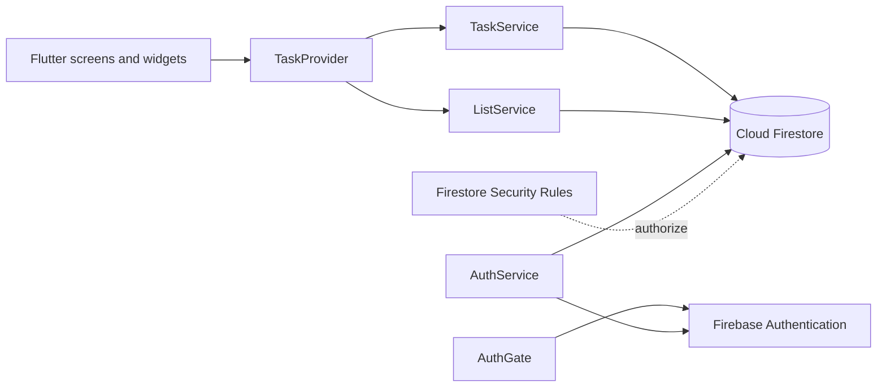
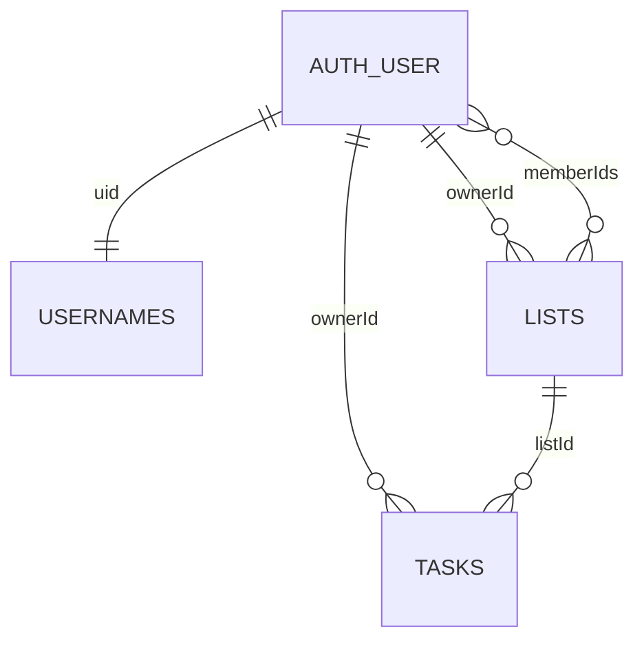
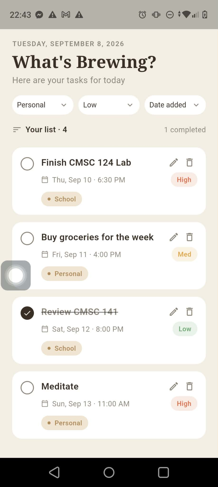
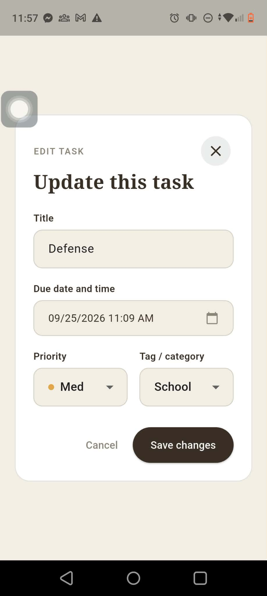
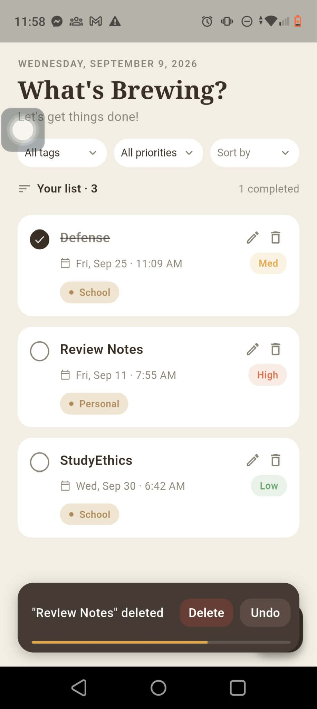

# To-Do List App (Multi-Account CRUD with User-Based Access Control)

A Flutter task-management app with Firebase email/password accounts. Each user
has a private **Personal** list and can create **Collaborative** lists, add
other users by username or email, and work on shared tasks together. Access is
enforced on the backend by Cloud Firestore Security Rules, not just in the UI.

This is the merged result of Activity 1 (CRUD To-Do List) and Activity 2
(Authentication and User Accounts), extended for Activity 3 (UBAC).

## Features

- Create an account with display name, username, email, and password.
- Sign in with username or email; sign out from the task list or account
  settings. After login the user lands directly on their own To-Do List.
- Request a password reset by username or email.
- Update display name and username; change email or password after confirming
  the current password. Email changes require verification.
- Create and edit tasks with a due date and time, priority, and tag; mark tasks
  complete or incomplete.
- Filter by tag and priority, sort by due date, priority, tag, or date added,
  and see task/completion counts.
- Delete with a four-second undo window, or confirm permanent deletion.
- Live updates through Firestore snapshots.
- **Personal list:** tasks only the owner can see or change.
- **Collaborative lists:** create a list, switch between lists from a dropdown
  and add members by username or email (owner only). A user sees only the lists
  they own or were added to.

## Technology

- **Frontend:** Flutter and Dart; targets Android and web.
- **State management:** Provider with `ChangeNotifier`.
- **Backend services:** Firebase Authentication (accounts, password hashing,
  sessions) and Cloud Firestore (data). The app uses Firebase's client SDKs
  directly, with no separate application server or REST API.
- **Authorization:** Firestore Security Rules (`firestore.rules`).
- **Other packages:** `intl` for date formatting.

## Backend and Database Refactor

There is no custom REST API or application server. Flutter calls Firebase
Authentication and Cloud Firestore through their client SDKs. Firestore
Security Rules run with the database and enforce authorization and data shape
for every client request.

### Architecture and request flow



- `AuthGate` observes Firebase Auth state and routes signed-in users to the
  task list; signed-out users see sign-in.
- `TaskProvider` owns the current user's task/list streams and screen state.
  `TaskService` and `ListService` isolate Firestore queries and writes from UI
  widgets.
- `AuthService` handles account operations and the Firestore username mapping.
- Firestore rules are the authorization boundary. Client-side checks improve
  usability but do not grant access.

### What the refactor changed

| Area | Refactored implementation | Why it matters |
| --- | --- | --- |
| Task ownership | Personal tasks are queried by both `ownerId` and `listId`; the Firestore SDK generates new task IDs and `TaskService` sets `ownerId` from the signed-in user. Rules independently require `ownerId == request.auth.uid`. | Avoids loading the whole collection and blocks a modified client from assigning another user's ownership ID. |
| Shared tasks | Collaborative task queries are scoped to one selected list; rules check that the user is a member. | Limits reads to the active list and enforces membership on the database. |
| Live data | One task stream is subscribed to for the active list. The previous per-list task-count listeners were removed. | Reduces duplicate listeners and reads while keeping task changes live. |
| Account switching | On auth changes, `TaskProvider` cancels old subscriptions and clears prior tasks, lists, selection, filters, and undo state before loading the new account. | Prevents stale state from one signed-in account appearing after another account signs in. |
| Task writes | Updates write only editable fields; `ownerId` and `listId` stay unchanged. Firestore rules validate the complete task shape and field values. | Preserves ownership and prevents malformed or unexpected task data. |
| Membership | The owner adds members with Firestore `arrayUnion`; rules restrict list updates to the owner. | Makes a member addition atomic and prevents non-owners from editing membership. |
| Username registration | Username availability is checked and the username mapping is written in a Firestore transaction. A failed username setup triggers cleanup of the newly created Auth account. | Avoids duplicate usernames and reduces the chance of a partially registered account. |
| UI filtering and sorting | Tag/priority filters and sort order are applied to the active task data in `TaskProvider`. | Changing a filter does not require another Firestore query or listener. |
| Delete undo | A deleted task is retained briefly for the four-second undo action, then permanently deleted unless restored. | Keeps undo behavior in provider state while the database remains the source of truth. |

### Data flow for a task

1. Firebase Authentication identifies the signed-in user.
2. `TaskProvider` subscribes to that user's personal tasks and collaborative
   lists. Selecting a collaborative list replaces the active task
   subscription.
3. Screens call provider methods for create, update, completion, delete, and
   undo actions; they do not write directly to Firestore.
4. `TaskService` performs the Firestore operation. Firestore checks the
   request against `firestore.rules` before accepting it.
5. Firestore snapshots update provider state, and Provider notifies the
   listening widgets to rebuild.

---

## How the Activities Were Combined

The work was developed in activity branches, with account management and
user-based access control integrated with the earlier CRUD implementation.
`main` was not developed on directly.

**Branch strategy**

| Branch | Contents |
| --- | --- |
| `crud-branch` & `ui-branch` | CRUD To-Do List: task model, `TaskService`, `TaskProvider`, task screens and widgets |
| `act2-accounts` | Firebase Auth, username mapping, sign-in/up/recovery/profile screens |
| `act3-ubac` | Created from `act2-accounts`, then the CRUD branch was merged in with `git merge`; conflicts were resolved on this branch |

`main` was not developed on directly.

**Integration points**

- `AuthGate` routes signed-in users to `TaskListScreen` and signed-out users
  to `SignInScreen`.
- `ChangeNotifierProvider` creates the shared `TaskProvider` above the app's
  screens.
- The task-list screen combines CRUD actions with profile and sign-out
  controls.
- The task model and services support both personal and collaborative lists;
  the refactor and security sections above explain their data flow and rules.

---

## Schema

Users live in Firebase Authentication (credentials are never stored in
Firestore). Firestore has three collections.



### `tasks/{taskId}`

| Field | Type | Description |
| --- | --- | --- |
| `id` | string | Must match the Firestore document ID; the app uses an SDK-generated ID. |
| `ownerId` | string | UID of the user who created the task; set from the signed-in account on create. |
| `listId` | string | `personal`, or the ID of a collaborative list. |
| `title` | string | Required; 1-200 characters. |
| `dueDateTime` | timestamp | Due date and time. |
| `createdAt` | timestamp | Creation time. |
| `priority` | string | Required enum: `low`, `medium`, or `high`. |
| `tag` | string | Required enum: `school`, `personal`, or `others`. |
| `isDone` | boolean | Whether the task is complete. |

### `lists/{listId}`

| Field | Type | Description |
| --- | --- | --- |
| `id` | string | Must match the Firestore document ID. |
| `name` | string | Required; 1-60 characters. |
| `ownerId` | string | UID of the creator; cannot be changed. |
| `memberIds` | list of strings | The app stores member UIDs; maximum 50 and always includes the owner. Rules check the list and its size but not each element's type. |
| `createdAt` | timestamp | Creation time. |

Task and list documents must contain all the fields shown above and no
additional fields. The Firestore rules validate the document ID, required
fields, top-level value types, and the listed length/enum constraints. For
`memberIds`, the rule checks that the value is a list and limits its size; the
app writes UID strings as the list entries.

The **Personal** list is not a document. It is any task with
`listId == 'personal'` and `ownerId == <your uid>`.

### `usernames/{username}`

| Field | Type | Description |
| --- | --- | --- |
| `uid` | string | Firebase Auth UID of the account |
| `email` | string | Account email, so a username can be resolved to an email at sign-in |

The document ID is the normalized username: 3-20 lowercase letters, digits,
or underscores. The document contains only `uid` and `email`; the email is
also maintained in Firebase Authentication. `AuthService.syncUsernameEmail()`
keeps it in step after an email change.

Tasks and lists store only UIDs, never names or emails, so user data is not
duplicated inside task records.

## Example API Endpoints (Database Access)

This app does not have its own REST API server. The Flutter client connects
directly to Firebase Authentication and Cloud Firestore using their SDKs. The
paths below are Firestore collection/document paths, not standalone HTTP
endpoints:

| Purpose | Firestore path | SDK operation |
| --- | --- | --- |
| Create a task | `tasks/{newTaskId}` | `TaskService.addTask()` creates a document with a generated ID. |
| Read personal tasks | `tasks` | Query by `ownerId == uid` and `listId == 'personal'`. |
| Read shared-list tasks | `tasks` | Query by `listId == listId`; Firestore rules require list membership. |
| Update or delete a task | `tasks/{taskId}` | `TaskService.updateTask()` or `deleteTask()`. |
| Create a collaborative list | `lists/{newListId}` | `ListService.createList()` creates a document with a generated ID. |
| Read the user's lists | `lists` | Query by `memberIds array-contains uid`. |
| Add a list member | `lists/{listId}` | `ListService.addMember()` updates `memberIds` with `arrayUnion`. |
| Resolve a username | `usernames/{username}` | Read the username document; email lookup uses a query on `usernames`. |

The following example shows concrete Firebase SDK calls after a user signs in.
In the app, `TaskService` wraps these task operations:

```dart
import 'package:cloud_firestore/cloud_firestore.dart';
import 'package:firebase_auth/firebase_auth.dart';
import 'package:todo_list_app/utils/constants.dart';

Future<void> exampleTaskCrud() async {
  final db = FirebaseFirestore.instance;
  final uid = FirebaseAuth.instance.currentUser?.uid;
  if (uid == null) throw StateError('Sign in first.');

  // CREATE: tasks/{generatedTaskId}
  final taskRef = db.collection('tasks').doc();
  await taskRef.set({
    'id': taskRef.id,
    'ownerId': uid,
    'listId': kPersonalListId,
    'title': 'Finish lab report',
    'dueDateTime': Timestamp.fromDate(DateTime(2026, 12, 1, 17)),
    'createdAt': Timestamp.now(),
    'priority': 'high',
    'tag': 'school',
    'isDone': false,
  });

  // READ: only this user's personal tasks.
  final myTasks = await db
      .collection('tasks')
      .where('ownerId', isEqualTo: uid)
      .where('listId', isEqualTo: kPersonalListId)
      .get();
  print('Found ${myTasks.docs.length} personal tasks.');

  // UPDATE: change editable fields at tasks/{taskId}.
  await db.collection('tasks').doc(taskRef.id).update({
    'title': 'Submit lab report',
    'isDone': true,
  });

  // DELETE: remove tasks/{taskId}.
  await db.collection('tasks').doc(taskRef.id).delete();
}
```

For collaborative lists, the app uses `ListService` and scopes task queries to
the list ID:

```dart
import 'package:cloud_firestore/cloud_firestore.dart';
import 'package:todo_list_app/services/list_service.dart';

Future<void> exampleSharedList() async {
  final listService = ListService();
  final list = await listService.createList('Project team');

  // Only the list owner can add a member.
  await listService.addMember(
    listId: list.id,
    identifier: 'teammate_username',
  );

  // The caller must be a member; Firestore rules enforce this as well.
  final sharedTasks = await FirebaseFirestore.instance
      .collection('tasks')
      .where('listId', isEqualTo: list.id)
      .get();
  print('Found ${sharedTasks.docs.length} shared tasks.');
}
```

Authentication examples: `AuthService.signUp(...)` creates a Firebase Auth
account and its unique `usernames/{username}` mapping;
`signInWithIdentifierAndPassword(...)` accepts either a username or email;
`sendPasswordResetEmailForIdentifier(...)` sends a reset email. These are SDK
operations, not routes hosted by this app.

Firebase Authentication handles account operations through its SDK. Firestore
Security Rules authorize database reads and writes for both the app and direct
client requests; the UI is not the security boundary.

### How they relate

- A task belongs to one user (`ownerId`) and one list (`listId`).
- A collaborative list has one owner and many members (`memberIds`).
- Visibility: a personal task is visible only to its owner; a shared task is
  visible to every member of its list.

---

## Access Control (UBAC)

Authentication is handled by Firebase Auth, so password hashing and session
handling are reused rather than re-implemented. Authorization is enforced by
**Firestore Security Rules on the server**. The UI only hides controls for
convenience; removing a check from the app does not open any data.

### Key rules (from `firestore.rules`)

```
function isListMember(listId) {
  return isSignedIn() && request.auth.uid in listData(listId).memberIds;
}

// Personal task: only its owner. Shared task: any member of its list.
function canAccessTask(data) {
  return isSignedIn() && (
    (data.listId == 'personal' && data.ownerId == request.auth.uid)
    || (data.listId != 'personal' && isListMember(data.listId))
  );
}
```

### Operations and where ownership is checked

| Operation | App code | Rule that enforces it |
| --- | --- | --- |
| Read my personal tasks | `getTasks(uid)` queries `ownerId == uid` and `listId == 'personal'` | `allow read: if canAccessTask(resource.data)` |
| Read a shared list's tasks | `getTasks(uid, listId: id)` queries `listId == id` | Same rule; passes only if `uid` is in `memberIds` |
| Create a task | `addTask()` sets `ownerId` to the signed-in UID | `ownerId == request.auth.uid` and `canAccessTask(new data)` |
| Update a task | `updateTask()` | `canAccessTask(old data)`; `ownerId` and `listId` cannot change |
| Delete a task | `deleteTask()` | `canAccessTask(old data)` |
| See my lists | `getMyLists(uid)` uses `memberIds arrayContains uid` | `allow read` only if `uid in memberIds` |
| Create a list | `createList()` | Caller is `ownerId` and the only initial member |
| Add a member | `addMember()` uses `FieldValue.arrayUnion` | `allow update` only if `resource.data.ownerId == request.auth.uid` |
| Delete a list | not exposed in the UI | Owner only |

```dart
// Personal tasks: filtered by owner AND the personal list.
_firestore.collection('tasks')
    .where('ownerId', isEqualTo: uid)
    .where('listId', isEqualTo: kPersonalListId);

// Shared tasks: the rules reject this query unless uid is a member.
_firestore.collection('tasks').where('listId', isEqualTo: listId);

// My lists: only lists whose memberIds contains my uid.
_firestore.collection('lists').where('memberIds', arrayContains: uid);
```

### IDOR prevention

Changing a task ID or list ID does nothing. A request for another user's
personal task fails the `ownerId == request.auth.uid` check, and a request for
a list the user was not added to fails `isListMember()`. Both return
`permission-denied`, never the data.

### Design decisions and trade-offs

- **Shared-list permissions:** any member can add, edit, complete, or delete
  tasks in a shared list. Only the list owner can add members or rename the
  list. Members cannot change a task's `ownerId` or `listId`.
- **Public username lookup:** `usernames` allows a single-document `get`
  without sign-in, because username login must resolve the email before the
  user is authenticated. Bulk listing is blocked.
- **Email lookup when adding a member:** signed-in users may run a
  single-result `usernames` query (`limit <= 1`) so "add by email" works. This
  lets a signed-in user check whether an email is registered. A Cloud Function
  would remove this exposure in production.
- **Password reset:** the app shows a generic confirmation when no account is
  found, so it does not reveal whether an account exists.

---

## Prerequisites

- Flutter SDK and the Dart SDK version allowed by `pubspec.yaml` (`^3.13.2`).
- Android Studio/emulator or a connected Android device, or a supported
  browser such as Chrome for web runs.
- Firebase CLI (for deploying the rules).
- Access to the Firebase project configured in `lib/firebase_options.dart`.

## Installation and Local Run

```bash
git clone <repository-url>
cd <repository-folder>
git checkout act3-ubac

flutter doctor
flutter pub get
flutter devices
flutter run
```

Use `flutter run -d chrome` to run in Chrome, or replace `chrome` with a device
ID shown by `flutter devices`. Run the widget tests with:

```bash
flutter test
```

## Install the Android APK

Download it from
the shared Google Drive folder:

**APK download:** [Google Drive APK folder](https://drive.google.com/drive/folders/1UuKyhHmLlbTKRMYy0Edf7JCaUkaCoBnl)

If prompted, allow the browser or file manager to **install unknown apps**, then confirm the installation. 

### Firebase setup

1. Open the Firebase project referenced by `lib/firebase_options.dart` and
   `android/app/google-services.json`.
2. In **Authentication > Sign-in method**, enable **Email/Password**.
3. Create the default Cloud Firestore database (configured location:
   `asia-southeast1`).
4. Deploy the checked-in rules from the repository root. **This step is
   required**: without it the app cannot read or write tasks and lists.

   ```bash
   firebase login
   firebase deploy --project cmsc-128-labs --only firestore:rules
   ```

No SQL schema or seed command is needed. Firestore creates the `tasks`,
`lists`, and `usernames` collections as the app writes its first documents.
Firebase Hosting is not configured; run the web target locally with Flutter.

## Testing Access Control

Register two or three accounts (for example Nikko, Victor, and a third user),
give each a few tasks, then verify:

1. Nikko cannot see Victor's personal tasks, and the reverse.
2. Nikko creates "Nikko's Group List" and adds Victor. Victor sees it in his
   dropdown; the third user does not.
3. Victor can add, edit, and delete tasks in Nikko's list; the "Add member"
   button does not appear for him.
4. Nikko does not see Victor's own group list until Victor adds him.
5. In the Firebase console **Rules Playground**, these requests are denied:
   - A user reading, updating, or deleting another user's personal task.
   - A non-member reading a task in a shared list.
   - A task create with someone else's `ownerId`.
   - A member changing a task's `ownerId` or `listId`.
   - A non-owner adding a UID to `memberIds`.
   - A signed-out read of `tasks` or `lists`.

Use the Firebase console (Firestore data tab) to inspect `usernames`, `tasks`,
and `lists`. No plaintext passwords are stored; Firebase Auth manages
credentials.

## Authentication and Session Behavior

`AuthService` wraps Firebase Authentication. Registration creates an
email/password account, sets the Firebase display name, and transactionally
creates `usernames/{normalizedUsername}` with the account UID and email. If
username setup fails, the newly created Auth account is deleted as cleanup.

For sign-in, an identifier containing `@` is treated as an email. Otherwise the
app looks up `usernames/{username}` and uses its email with Firebase
Authentication. The Firebase Auth SDK persists the session across refreshes,
back navigation, and app restarts; `AuthGate` listens to `authStateChanges()`
and shows the signed-in user's own list or the sign-in screen. Signing out
clears the session, and `TaskProvider` drops all of that user's data.

Password recovery accepts the same username-or-email identifier and sends
Firebase's password-reset email.

## Project Structure

```text
firestore.rules
lib/
├── firebase_options.dart
├── main.dart
├── models/
│   ├── task.dart
│   └── task_list.dart
├── providers/
│   └── task_provider.dart
├── screens/
│   ├── form_task_screen.dart
│   ├── password_recovery_screen.dart
│   ├── profile_screen.dart
│   ├── sign_in_screen.dart
│   ├── sign_up_screen.dart
│   └── task_list_screen.dart
├── services/
│   ├── auth_service.dart
│   ├── list_service.dart
│   └── task_service.dart
├── utils/
│   ├── auth_error_translator.dart
│   └── constants.dart
└── widgets/
    ├── auth_form/
    │   ├── auth_password_field.dart
    │   ├── auth_submit_button.dart
    │   └── auth_text_field.dart
    ├── profile/
    │   ├── profile_avatar_header.dart
    │   └── section_header.dart
    ├── task_form/
    │   ├── task_due_date_field.dart
    │   ├── task_form_actions.dart
    │   ├── task_form_decoration.dart
    │   ├── task_form_header.dart
    │   ├── task_options_row.dart
    │   └── task_title_field.dart
    ├── add_member_dialog.dart
    ├── badges.dart
    ├── delete_confirm_dialog.dart
    ├── dropdown.dart
    ├── empty_state.dart
    ├── filter_sort_bar.dart
    ├── filter_sort_sheet.dart
    ├── list_header.dart
    ├── list_switcher.dart
    ├── new_list_dialog.dart
    ├── task_tile.dart
    └── undo_snackbar.dart
```

## Screenshots

<p float="left">
  
  
  
</p>